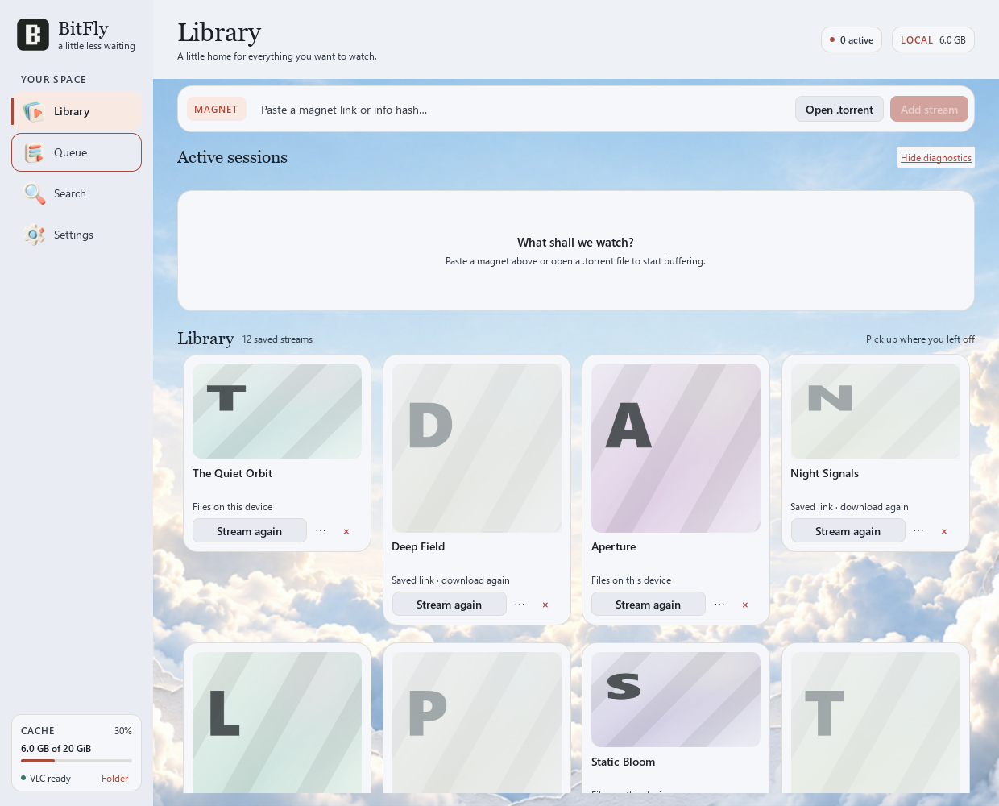

#  BitFly

**Press play before the download is done.**

Found something to watch? Paste its magnet link, choose the video, and press **Play**. BitFly brings the pieces together while your media player handles the screen. When you're done, your links, file selections and artwork have a little home to come back to.

Built for Windows in C++ and Qt Quick. VLC, mpv and MPC-HC/BE are welcome.

[](https://github.com/aryan-astra/BitFly-torrent-stream/releases/latest) [](https://github.com/aryan-astra/BitFly-torrent-stream/actions/workflows/windows.yml) [](https://github.com/aryan-astra/BitFly-torrent-stream/releases/latest) [](LICENSE)

[Get BitFly](#get-bitfly) · [Take a look](#a-little-home-for-what-you-watch) · [How it works](#under-the-clouds) · [Build it](#for-developers)

## Get BitFly

**[Latest stable release →](https://github.com/aryan-astra/BitFly-torrent-stream/releases/latest)**

| Windows PC | Installer | Portable | Checksum |
| --- | --- | --- | --- |
| **x64** · most Intel / AMD PCs | [Installer](https://github.com/aryan-astra/BitFly-torrent-stream/releases/download/v1.0.3/BitFly-1.0.3-windows-x64-setup.exe) | [Portable ZIP](https://github.com/aryan-astra/BitFly-torrent-stream/releases/download/v1.0.3/BitFly-1.0.3-windows-x64.zip) | [SHA-256](https://github.com/aryan-astra/BitFly-torrent-stream/releases/download/v1.0.3/BitFly-1.0.3-windows-x64-SHA256SUMS.txt) |
| **ARM64** · Windows on Arm PCs | [Installer](https://github.com/aryan-astra/BitFly-torrent-stream/releases/download/v1.0.3/BitFly-1.0.3-windows-arm64-setup.exe) | [Portable ZIP](https://github.com/aryan-astra/BitFly-torrent-stream/releases/download/v1.0.3/BitFly-1.0.3-windows-arm64.zip) | [SHA-256](https://github.com/aryan-astra/BitFly-torrent-stream/releases/download/v1.0.3/BitFly-1.0.3-windows-arm64-SHA256SUMS.txt) |

Downloads above are **v1.0.3**. The installer works per user without administrator rights. Prefer a folder you can move around? Unzip the portable build and run `BitFly.exe`; no installation is needed. Preferences and library state still live in your Windows user profile.

You'll need **Windows 10 1809+ on x64, or Windows 11 on x64 / ARM64**, and an installed supported player. **VLC 3.x** is the simplest starting point and is also needed for video-frame previews. Players are installed separately.

Release EXEs are not Authenticode signed; Windows may show an unknown-publisher warning. Git signatures and download checksums are separate from Windows publisher signing.

<details>
<summary>Check a download's SHA-256</summary>

Download the matching checksum file, then compare its value with:

```powershell
Get-FileHash .\BitFly-1.0.3-windows-x64.zip -Algorithm SHA256
Get-Content .\BitFly-1.0.3-windows-x64-SHA256SUMS.txt
```

</details>

## Your first stream

1. **Make yourself at home.** Open BitFly. If your player isn't detected, choose its executable in **Settings**.
2. **Bring something to watch.** Paste a magnet link or choose **Open .torrent**, then select the video you want.
3. **Press Play.** Your player opens when the starting pieces are verified. BitFly keeps downloading ahead as it plays; seeking asks for a different range of the file.

BitFly supports **v1, v2 and hybrid torrents**. Playback depends on the swarm: healthy peers help; a quiet or unavailable swarm can still leave you waiting.

## A little home for what you watch



*Interface preview with sample library entries. Covers and controls are rendered by the app's QML components.*

- **Active sessions stay close.** File selection, download progress, buffer state and player controls sit together.
- **Your library remembers.** Magnets, selected files and artwork survive a restart. Entries with retained files stay bright; saved links without local data are dimmed. **Stream again** reopens the saved entry.
- **Covers get some room.** Optional VLC frame previews open out from a circle into a square or landscape cover. You can choose your own artwork or refresh a frame from the card's menu.
- **The queue keeps your place in line.** Add files, reorder them, and launch the next one from one place. The queue survives a restart too.

The interface keeps its blue skies, paper clouds and small tactile icons, with short transitions and a reduced-motion setting. Hover over a question mark—or focus it with the keyboard—for an explanation of a setting.

## When the credits roll

Close a player launched by BitFly and choose what happens next:

| Choice | What happens |
| --- | --- |
| **Keep** | Retain the downloaded data and pause the session's network activity. |
| **Delete** | Remove that session's managed data after confirmation. Its saved library entry and artwork can stay. |
| **Seed** | Keep sharing for the duration you choose. Extra seeding is an explicit choice. |

Removing a library entry is a separate action and removes its saved artwork too. BitFly only cleans up data inside its own managed session folders.

## Room for your setup

| In Settings | Make it yours |
| --- | --- |
| **Player** | Use VLC, mpv, or MPC-HC/BE. Playback stays in that external app. |
| **Storage** | Choose a download folder and a cache quota. A folder change applies to new sessions; active ones keep their existing location. |
| **Connections** | Set download/upload limits, peer slots, discovery controls and how far ahead BitFly prioritizes pieces. |
| **Search** | Connect your own Jackett/Prowlarr Torznab feed. Its indexers supply the results; BitFly doesn't provide a torrent catalog. |
| **Cloudflare** | Control a separately installed compatible Cloudflare client. Nothing is bundled or connected automatically. |
| **Updates** | Check each time BitFly starts and download newer stable installers in the background. Size and SHA-256 are verified; **Install update** saves sessions and closes BitFly before updating its current folder. |

[Integration details →](docs/INTEGRATIONS.md)

<details>
<summary>Can it keep deleting played pieces to fit a movie into less disk space?</summary>

Not currently. Read-ahead controls which pieces receive priority; it doesn't turn the download into a rolling, self-deleting disk buffer. Selected media must fit the managed quota and available disk space. Use a larger download folder, raise the quota when there is room, or remove retained data you no longer need.

</details>

<details>
<summary>Does the portable version stay portable when updating?</summary>

The ZIP can run without installation. The in-app updater uses the installer and targets the running app's folder, registering it as a per-user installation. To keep using the ZIP without that registration, replace it manually with a new portable download. Library and preferences remain in your Windows user profile.

</details>

## Under the clouds

Your player asks for bytes. BitFly fetches the corresponding torrent pieces and serves them only after libtorrent has verified them.


The stream listens on loopback, uses an unpredictable session token and validates the host. It exposes stream IDs rather than filesystem paths. The UI and SQLite state live on the GUI thread; one worker owns the torrent engine, verified cache and HTTP server. Preview capture uses a bounded queue and one owned VLC decoder.

No BitFly account, ads or telemetry. Your library and preferences stay on your PC. Torrent peers, trackers, configured search services and GitHub update checks still make their normal network connections. Search API keys are protected with your Windows account.

[Architecture](docs/ARCHITECTURE.md) · [Interface contracts](docs/CONTRACTS.md) · [Storage and cleanup](docs/CONTRACTS.md#engine-and-storage)

## For developers

**C++20 · Qt 6.8.3 / Qt Quick · libtorrent 2.0.11 · Boost 1.86 · OpenSSL · SQLite**

Use the compiler that matches your Qt kit. Local development uses MinGW 13.1; GitHub Actions builds and tests native MSVC packages for x64 and ARM64. A version tag matching CMake triggers the release pipeline, including package smoke tests and checksum checks before publication.

<details>
<summary>Build locally with the MinGW Qt kit</summary>

Install the matching Qt kit and dependencies first, then adjust these paths:

```powershell
git clone https://github.com/aryan-astra/BitFly-torrent-stream.git
cd BitFly-torrent-stream
$env:PATH="C:\Qt\Tools\mingw1310_64\bin;C:\Qt\6.8.3\mingw_64\bin;$env:PATH"
cmake -S . -B build -G Ninja -DCMAKE_BUILD_TYPE=Release `
  -DCMAKE_PREFIX_PATH=C:/Qt/6.8.3/mingw_64 `
  -DBITFLY_LIBTORRENT_SOURCE=C:/deps/libtorrent `
  -DBITFLY_BOOST_ROOT=C:/deps/boost_1_86_0 `
  -DOPENSSL_ROOT_DIR=C:/deps/openssl
cmake --build build --parallel 1
ctest --test-dir build --output-on-failure
.\build\BitFly.exe
```

[Build guide](docs/BUILD.md) covers dependency setup and other toolchains. The integration tests use synthetic media and a local seeder.

</details>

[Testing](docs/TESTING.md) · [Contributing](CONTRIBUTING.md) · [Release process](docs/RELEASE.md) · [Third-party notices](THIRD_PARTY_NOTICES.md)

## The edges we're still working on

The stable x64 and ARM64 release passed hosted build, test and package checks. Local Windows runs have also exposed intermittent controller/recovery failures, including a v2 byte-range timeout; those remain under investigation. Physical Windows 10 / ARM64 VLC playback and a real installer upgrade haven't been fully validated. [Validation notes and evidence](docs/STATUS.md) keep that distinction visible.

BitFly doesn't track an external player's exact playback position. It doesn't bundle a player, indexer or VPN, and it doesn't bypass DRM. Use torrents you have the right to access and share. Please report bugs through [Issues](https://github.com/aryan-astra/BitFly-torrent-stream/issues); report security problems privately using [SECURITY.md](SECURITY.md).

---

Made by [Aryan Shukla](https://github.com/aryan-astra), with C++ and a little cloud cover.

[MIT licensed](LICENSE). Dependency licenses and redistribution notes are in [THIRD_PARTY_NOTICES.md](THIRD_PARTY_NOTICES.md). [Banner artwork and prompt](docs/branding/banner-prompt.md).
