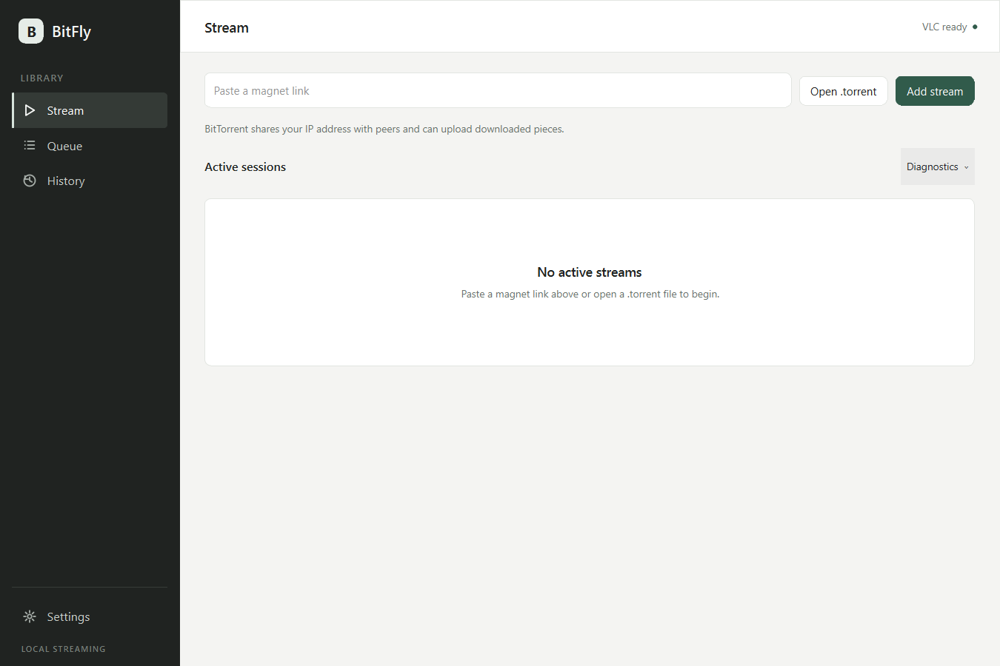

# BitFly

[](https://github.com/aryan-astra/BitFly-torrent-stream/releases)
[](https://github.com/aryan-astra/BitFly-torrent-stream/actions/workflows/windows.yml)
[](https://github.com/aryan-astra/BitFly-torrent-stream/actions/workflows/source-checks.yml)
[](LICENSE)

BitFly is a native Windows application for streaming torrent video in your
installed external player (VLC by default; mpv and MPC-HC/BE are supported).
Open a magnet link or a `.torrent` file, choose a media file, and the player reads a local
token-protected HTTP stream while libtorrent fetches the pieces that playback
needs.



> **Local v1 candidate.** This working tree prepares version 1.0.2 with the new
> library, white cloud interface, search and update controls. It has not been
> pushed or published. The downloads below remain `v0.1.0-preview.1`, for evaluation, not as
> a stable or production-certified release. The binaries are not Authenticode
> signed, so Windows may show a publisher warning. See
> [validation status](docs/STATUS.md) for executed checks, evidence, and the
> remaining release gates.

## Download

The current prerelease is [v0.1.0-preview.1](https://github.com/aryan-astra/BitFly-torrent-stream/releases/tag/v0.1.0-preview.1).

| Platform | Installer (per-user) | Portable ZIP | Checksums |
| --- | --- | --- | --- |
| Windows x64 | [BitFly 0.1.0 x64 setup (29.7 MB)](https://github.com/aryan-astra/BitFly-torrent-stream/releases/download/v0.1.0-preview.1/BitFly-0.1.0-windows-x64-setup.exe) | [BitFly 0.1.0 x64 ZIP (44.4 MB)](https://github.com/aryan-astra/BitFly-torrent-stream/releases/download/v0.1.0-preview.1/BitFly-0.1.0-windows-x64.zip) | [x64 SHA-256](https://github.com/aryan-astra/BitFly-torrent-stream/releases/download/v0.1.0-preview.1/BitFly-0.1.0-windows-x64-SHA256SUMS.txt) |
| Windows ARM64 | [BitFly 0.1.0 ARM64 setup (20.6 MB)](https://github.com/aryan-astra/BitFly-torrent-stream/releases/download/v0.1.0-preview.1/BitFly-0.1.0-windows-arm64-setup.exe) | [BitFly 0.1.0 ARM64 ZIP (30.7 MB)](https://github.com/aryan-astra/BitFly-torrent-stream/releases/download/v0.1.0-preview.1/BitFly-0.1.0-windows-arm64.zip) | [ARM64 SHA-256](https://github.com/aryan-astra/BitFly-torrent-stream/releases/download/v0.1.0-preview.1/BitFly-0.1.0-windows-arm64-SHA256SUMS.txt) |

The installer runs without administrator rights, installs under
`%LOCALAPPDATA%\Programs\BitFly`, and can be removed from Windows Settings. The
portable ZIP contains the same application and needs no installation. Unpack it
to a folder you control and run `BitFly.exe`.

Verify a download before running it:

```powershell
Get-FileHash .\BitFly-0.1.0-windows-x64.zip -Algorithm SHA256
Get-Content .\BitFly-0.1.0-windows-x64-SHA256SUMS.txt
```

## Requirements

- Windows 10 version 1809 or later (x64), Windows 11 (x64), or Windows 11 on
  ARM64. Windows 11 x64 is the validated development host; the other targets
  have the validation gaps recorded in [STATUS.md](docs/STATUS.md).
- An installed VLC 3.x, mpv or MPC-HC/BE player. Choose its executable in
  Settings. VLC is additionally needed for optional frame previews. Players
  are not bundled or automatically installed.
- Media you are authorized to access and share. Optional search connects to
  your configured Jackett/Prowlarr Torznab feed. BitFly supplies no catalog
  or DRM circumvention.

## Use

1. Install or unpack BitFly, then start it. If VLC is not detected, choose
   a supported player in **Settings**.
2. Paste a magnet link on the **Library** page, or choose **Open .torrent**.
3. Select a playable file and press **Play**. *Preparing* means BitFly is still
   retrieving the pieces needed to start. VLC opens once the initial verified
   range is available.
4. Playback continues while BitFly downloads ahead of VLC's requests. Seeking
   changes the requested byte ranges and reprioritizes pieces.

Use **Queue** to line up files for the next VLC session and **Library** to relaunch
a previous stream from its saved magnet and selection. Queue and library survive a restart. State is saved
transactionally, and torrent resume data is reused where available; playback
always requires an explicit launch.

When an owned VLC window closes, BitFly asks whether to **Keep** the data,
**Delete** it, or **Seed** temporarily. Keeping data pauses network activity;
deleting requires confirmation and affects only that managed cache entry; further seeding
requires an explicit choice and has a configurable duration (default 0).

## Features

- Magnet links and `.torrent` files, including v1, v2, and hybrid torrents.
- Range-driven piece scheduling with verified-only reads; HTTP never serves
  unverified bytes or invents data when the swarm is slow.
- A loopback HTTP server with an unpredictable per-session token, strict host
  validation, and no filesystem paths in URLs.
- Playable-file selection, multiple sessions, pausing, and removal.
- Persistent queue, media library/artwork, preferences, and libtorrent resume state in
  local SQLite storage.
- Cache quota admission, bounded temporary seeding, retained data, and
  user-confirmed deletion of managed data.
- Native C++20/Qt Quick white interface, 3D sidebar icons, short cover/hover
  transitions, reduced motion and a virtualized library.
- Custom artwork and optional bounded frame previews through installed VLC.
- Selectable storage folder, supported network/discovery limits, and optional
  Torznab search with Windows-account-protected API keys.
- Installed Cloudflare client controls; no bundled VPN or automatic network changes.
- Stable update checks on each launch, background size/hash-verified downloads,
  and an explicit install action. No telemetry or BitFly account.

## How it works

```text
VLC  ──HTTP byte ranges──▶  loopback server  ──▶  scheduler + verified cache  ──▶  libtorrent
```

The Qt Quick UI, controller, and persistence run on the GUI thread. One worker
thread owns libtorrent, the piece cache, scheduling, and the HTTP server.
Owned VLC processes are launched with the local stream URL and remain external to
BitFly. See [docs/ARCHITECTURE.md](docs/ARCHITECTURE.md) for the ADR and
[docs/CONTRACTS.md](docs/CONTRACTS.md) for interface boundaries.

## Build and test

BitFly builds with CMake, Qt 6.8.3, libtorrent 2.0.11, Boost 1.86, and OpenSSL.
Local development uses MinGW 13.1; CI builds native MSVC x64 and ARM64 packages on
Windows runners.

```powershell
cmake -S . -B build -G Ninja -DCMAKE_BUILD_TYPE=Release `
  -DCMAKE_PREFIX_PATH=C:/Qt/6.8.3/mingw_64 `
  -DBITFLY_LIBTORRENT_SOURCE=C:/deps/libtorrent `
  -DBITFLY_BOOST_ROOT=C:/deps/boost_1_86_0 `
  -DOPENSSL_ROOT_DIR=C:/deps/openssl
cmake --build build --parallel 1
ctest --test-dir build --output-on-failure
```

See [docs/BUILD.md](docs/BUILD.md) for dependency versions and alternative
toolchains, and [docs/TESTING.md](docs/TESTING.md) for the HTTP, scheduler,
persistence, QML, integration, VLC-decode, and packaged-app checks. The
integration suite uses local deterministic torrents and does not require a public
swarm.

## Status and limitations

The new candidate and older public preview have separate validation records:

- Local x64 validation includes real-torrent streaming in v1, v1-magnet,
  v2-magnet, and hybrid modes, verified HTTP ranges, restart/resume, and audio
  decoded through the actual tokenized HTTP URL by external VLC.
- The prior preview passed native x64/ARM64 CI packaging and startup. Those
  runs do not validate this unpushed v1 source; fresh release CI remains a gate.
- Physical Windows 11 ARM64 VLC playback, physical Windows 10 testing, sustained
  concurrent playback, disk-full/crash fault injection, screen-reader review,
  and controlled cold-start benchmarks remain outstanding.
- The streaming evidence comes from one local seeder and one media fixture, not a
  public swarm at scale.
- Binaries are unsigned and have no stable security-maintenance commitment yet.
- Exact VLC playback position is not tracked or restored. BitFly does not bundle
  a player, indexer, or Cloudflare client, find subtitles, or bypass DRM.
- Updates use GitHub's latest **stable** release and ignore prereleases.
  Integrity trusts the official HTTPS API digest; no independent publisher
  signing identity or silent unattended install is implied.

The authoritative evidence and release gates are in [docs/STATUS.md](docs/STATUS.md).
Do not treat a screenshot or a successful launch as proof of a platform or
codec path that is not listed there.

## Contributing

Read [CONTRIBUTING.md](CONTRIBUTING.md) before opening a pull request. Changes
need focused tests and a clear description of user-visible behavior. Report
security issues privately according to [SECURITY.md](SECURITY.md), and never post
private torrents, credentials, or personal paths in a public issue.

## License

BitFly is released under the [MIT License](LICENSE). Dependencies keep their own
licenses; see [THIRD_PARTY_NOTICES.md](THIRD_PARTY_NOTICES.md) and
[docs/RELEASE.md](docs/RELEASE.md) for packaging and redistribution details.
